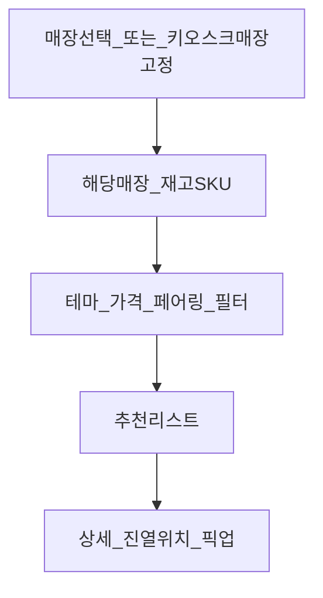

# 와인 O2O 사업기획서 (초안)

**사업명(가칭):** CellarMatch — 매장 재고 기반 테마 와인 큐레이션  
**문서 버전:** 0.1  
**작성 기준일:** 2026-10-25  
**언어:** 한국어  

---

## 0. 핵심 제품 원칙 (Non-negotiable)

```
추천 결과 = f(테마, 가격대, 페어링, …) ∩ 선택_매장.재고(수량 > 0)
```

| 원칙 | 설명 |
|------|------|
| **재고 우선** | 앱·키오스크가 소개하는 와인은 **해당 매장이 실제로 보유한 SKU만** 노출한다. |
| **매장 컨텍스트** | 고객은 “방문/픽업할 매장”을 먼저(또는 자동) 정한 뒤 큐레이션을 받는다. |
| **품절 즉시 제외** | 재고 0이면 추천·검색·테마 카드에서 빠진다. (대체 후보만 같은 재고 풀에서 재선정) |
| **카탈로그 ≠ 판매 가능** | 마스터 와인 DB는 메타데이터용이며, **판매 가능 여부는 매장 재고가 결정**한다. |

이 원칙이 깨지면 O2O 가치가 사라지고 “온라인에만 있는 와인”을 추천하는 일반 콘텐츠 앱이 된다.



---

## 1. 표지 · 요약 (Executive Summary)

| 항목 | 내용 |
|------|------|
| **한 줄 정의** | 생일·승진·음식 페어링·예산에 맞는 와인을 **지금 이 매장 재고 안에서** 앱·키오스크로 바로 찾아주는 O2O 큐레이션 |
| **해결 문제** | “어떤 와인을 살지” 모름 + 매장 상담 병목 + 추천이 재고와 안 맞아 실망하는 경험 |
| **핵심 솔루션** | 테마·페어링·가격 필터 × **매장 실시간/배치 재고** + 동일 엔진의 매장 키오스크 |
| **타깃** | B2C: 선물·입문·홈파티 소비자 / B2B: 독립 와인 소매점 |
| **수익** | 매장당 SaaS·키오스크 구독 우선, 이후 픽업 리드·스폰서 슬롯 |
| **단계** | MVP(샘플 재고) → 파일럿 매장 3~10 → 다점포·POS 연동 |

상세 1페이지: [피치-원페이지.md](./피치-원페이지.md)

---

## 2. 문제 정의 · 시장 기회

### 2.1 소비자 Pain

- 와인 정보가 많아도 **오늘 살 수 있는 병**이 무엇인지 모름
- 온라인 추천을 보고 매장에 가면 **품절·미취급**인 경우 빈번
- 생일·승진·집들이 등 **상황(테마)** 에 맞는 선택이 어려움
- 음식과의 조합, 가격대에 대한 실패 불안

### 2.2 매장 Pain

- 피크타임 상담 부하, 직원별 추천 편차
- 재고는 있는데 고객이 찾지 못해 **회전이 느린 SKU** 존재
- 키오스크/사이니지가 있어도 **재고·테마와 비연결**

### 2.3 기회

- “소개(콘텐츠)”와 “살 수 있음(인벤토리)”을 한 화면에서 결합하면 O2O 전환이 명확해짐
- 매장 입장: 보유 재고를 테마로 소진·교차판매하는 **셀프 소믈리에**
- 1차 시장: 독립 와인숍 → 확장: 대형마트 와인존, H&B, 호텔·레스토랑

### 2.4 시장 규모 초안 (가정 · 검증 필요)

| 층 | 가정 | 초안 수치(예시) |
|----|------|-----------------|
| TAM | 국내 와인 소매·전문점 디지털 큐레이션/키오스크 관련 지출 | 가정: 연 수백억 원대 잠재 (별도 리서치) |
| SAM | 독립·중소 와인숍 중 재고 디지털화 가능 매장 | 가정: 전국 1,000~3,000개 중 초기 타깃 300개 |
| SOM | 24개월 유료 전환 매장 | 가정: 파일럿 10 → Year1 80 → Year2 200 |

> 수치는 **가설**이다. 파일럿에서 매장 ARPU·전환율로 보정한다.

---

## 3. 비전 · 포지셔닝 · 가치제안

- **비전:** “사는 매장 선반 위에서 바로 고르는 와인 큐레이터”
- **포지션:** 쇼핑몰이 아니라 **매장 재고 위의 발견·전환 레이어**
- **가치제안**
  - **소비자:** 테마·예산·음식으로 고르되, **지금 이 매장에서 살 수 있는 병만** 본다
  - **매장:** 상담 없이도 보유 재고가 테마별로 소개되고, 진열 위치까지 안내
  - **수입사(확장):** “재고 있는 매장”에만 노출되는 프로모션 (신뢰 가드 적용)

---

## 4. 고객 · 페르소나 · JTBD

| 세그먼트 | 니즈 | JTBD |
|----------|------|------|
| 선물 구매자 | 분위기·가격·실패 최소화 | “승진 선물로 민망하지 않고, **이 매장에 있는** 와인” |
| 홈파티/홈쿡 | 음식 페어링 | “스테이크에 맞는 **3만 원대, 오늘 픽업 가능**” |
| 입문자 | 난이도↓ | “틀리지 않는 한 병 — **재고 있는 것 중**” |
| 매장 방문객(키오스크) | 즉시 조회 | “선반 돌기 전에 후보를 재고 기준으로 좁히기” |
| 매장 운영자 | 상담 효율·재고 소진 | “직원 적어도 **우리 재고**가 테마로 팔리게” |

### 페르소나 요약 (4)

1. **민수 (32, 선물)** — 상사 승진 선물, 4~7만 원, 실패 싫음 → 테마 “승진/격식” + 매장 재고  
2. **혜진 (28, 홈쿡)** — 스테이크 페어링, 2~4만 원 → 페어링 + 가격 + 재고  
3. **도윤 (41, 입문)** — “레드 아무거나”에서 탈출 → 입문 테마 + 재고 top N  
4. **소연 (매장 오너)** — 주말 상담 폭주, 재고 200SKU → 키오스크로 1차 필터링

---

## 5. 상품 · 서비스 구성

### 5.1 소비자 앱/웹

**진입 순서 (권장)**

1. 매장 선택 (GPS·즐겨찾기·QR) **또는** 매장 QR로 딥링크 → 매장 고정  
2. 탐색 축 선택: **테마 / 가격대 / 음식 페어링** (조합 가능)  
3. 결과: **해당 매장 재고 ∩ 필터** 정렬 리스트  
4. 상세: 스토리, 맛 프로필, 페어링, **재고 수량·진열 존**, 유사 와인(역시 동일 재고)  
5. 위시·공유·픽업 문의/예약(파일럿)

**절대 하지 않음:** 타 매장·온라인몰에만 있는 SKU를 “추천”으로 섞기 (비교·이관은 명시적 “다른 매장 보기”로만)

### 5.2 매장 키오스크

- 매장 ID 고정(디바이스 설정)
- 동일 추천 엔진, 터치 최적화(큰 테마 카드, 가격 슬라이더)
- 재고 0 숨김, 진열 위치 강조
- QR → 스마트폰에서 같은 매장 컨텍스트로 이어보기
- 직원 호출(선택)

### 5.3 매장 어드민

- SKU·재고 수량·진열 존·판매가 관리 (CSV/API)
- 테마·페어링 태그 매핑 (본사 템플릿 + 매장 커스텀)
- 키오스크/앱 노출 on/off, 시즌 테마
- 퍼널: 조회 → 상세 → 위시/픽업 (구매는 POS 연동 시 보강)

### 5.4 데이터 모델 초안

| 엔티티 | 역할 |
|--------|------|
| `WineMaster` | 품종·산지·테이스팅·기본 태그 (메타) |
| `Store` | 매장 프로필, 키오스크 설정 |
| `StoreInventory` | `store_id + sku`, `qty`, `price`, `shelf_zone`, `updated_at` |
| `Theme` / `PairingTag` / `PriceBand` | 큐레이션 축 |
| `WineTagMap` | 마스터 또는 매장 오버라이드 태그 |
| `RecommendSession` | 매장 컨텍스트 + 필터 + 노출 SKU 로그 |
| `Wishlist` / `PickupRequest` | O2O 전환 |
| `KioskDevice` | 디바이스 ↔ 매장 바인딩 |

**추천 쿼리 의사코드**

```
candidates = StoreInventory.where(store_id, qty > 0)
candidates = candidates.join(WineMaster).filter(theme, pairing, price_band)
return rank(candidates, rules)
```

기능 우선순위: [MVP-백로그.md](./MVP-백로그.md)  
태그 체계: [태그-사전.md](./태그-사전.md)

---

## 6. O2O 운영 시나리오

### 6.1 온라인 → 오프라인 (앱)

1. 고객이 근처/단골 매장 선택  
2. “승진 선물” + 5만 원대 선택  
3. **그 매장 재고**에서 3~5병 추천  
4. 위시 저장 또는 픽업 희망 시간 남김  
5. 매장 방문·결제 (POS)

### 6.2 오프라인 단독 (키오스크)

1. 매장 입장 → 키오스크에서 “스테이크” + 가격  
2. 재고 있는 병만 표시 + 진열 존(예: A-12)  
3. 병 픽 → 계산대

### 6.3 하이브리드

1. 키오스크에서 후보 확정 → QR로 앱 위시  
2. 동행과 공유 후 재방문·구매

### 6.4 매장 머천다이징

- 회전 느린 SKU에 테마 태그 보강 → 재고 내 노출 빈도↑  
- 시즌 테마(연말·추석)로 **보유분** 소진 캠페인

---

## 7. 비즈니스 모델 · 수익

| 수익원 | 설명 | 단계 |
|--------|------|------|
| SaaS / 키오스크 구독 | 매장당 월 이용료 + 디바이스 리스/판매 | **핵심 (B2B)** |
| 픽업·리드 수수료 | 앱 예약이 방문으로 이어질 때 | 중기 |
| 스폰서드 슬롯 | 수입사 프로모션 — **해당 매장 재고에 있을 때만** 노출 | 중기 |
| 수요 인사이트 | 테마·지역별 “재고 대비 관심” 리포트 | 후기 |
| HW 마진 | 키오스크 판매/리스 | 선택 |

### 단위경제 초안 항목 (가정)

| 항목 | 가정 예시 | 비고 |
|------|-----------|------|
| 매장 월 ARPU | 15~40만 원 | 플랜·키오스크 대수 |
| 매장 CAC | 50~150만 원 | BD·설치·온보딩 |
| 키오스크 원가 | 80~200만 원/대 | 리스 시 회수 기간 설계 |
| 목표 payback | 6~12개월 | 파일럿으로 검증 |
| 키오스크 세션→관심 | 세션의 20%+ 상세 | KPI로 추적 |
| 재고 데이터 최신성 | 일 1회 이상 (목표: 근실시간) | 품질 = 제품 신뢰 |

---

## 8. Go-to-Market

- **파일럿:** 재고 CSV/시트 협조 가능한 독립 와인숍 3~10곳  
- **세일즈 피치:** “우리 매장에 있는 술만 똑똑하게 소개 → 상담 시간↓, 재고 회전↑”  
- **소비자:** 매장 QR, 네이버 로컬, 선물 시즌  
- **파트너:** POS/재고, 키오스크 HW, 수입사(재고 연동 프로모션)

### 90일 파일럿 스케치

| 기간 | 목표 |
|------|------|
| D1–30 | 매장 온보딩, 재고·태그 적재, 키오스크 1대, 앱 매장 모드 |
| D31–60 | 실사용, 퍼널 로그, 태그 품질 교정 |
| D61–90 | KPI 리뷰, 유료 전환 조건, POS 연동 우선순위 결정 |

---

## 9. 경쟁 · 차별화

| 비교 대상 | 한계 | CellarMatch |
|-----------|------|-------------|
| 오픈마켓 와인관 | 매장 재고와 무관 | **매장 재고 ∩ 추천** |
| 일반 주류 콘텐츠 앱 | “볼 수는 있어도 여기선 못 삼” | 매장 컨텍스트 필수 |
| 단순 디지털 사이니지 | 테마·재고 미연동 | 동일 엔진 앱+키오스크 |
| 인적 소믈리에 | 스케일·편차 | 보조·대체 1차 필터 |

**방어:** 매장 네트워크의 재고·테마 행동 데이터, 온보딩 툴, 큐레이션 품질

---

## 10. 운영 · 콘텐츠 · 컴플라이언스

- **콘텐츠:** 테마/페어링 가이드, 시즌 캘린더 — 태그는 재고 SKU에만 의미 있음  
- **재고 연동 단계:** ① CSV/시트 → ② 스케줄 API → ③ POS 플러그인  
- **품절 정책:** 노출 즉시 제외, 세션 중 품절 시 “같은 테마 재고 대체” 제안  
- **법무:** 주류 광고·판매 규제, 키오스크 연령 고지/확인, 개인정보, 위치  
- **스폰서 가드:** 유료 노출은 라벨 분리 + **재고 있는 SKU만**

---

## 11. 기술 아키텍처 개요

| 레이어 | 구성 |
|--------|------|
| 클라이언트 | 반응형 웹 + 키오스크 풀스크린(PWA), 이후 스토어 앱 |
| API | 매장 컨텍스트 추천, 재고, 세션 로그, 어드민 |
| 데이터 | WineMaster, StoreInventory(핵심), 태그, 세션 |
| 연동 | 재고 CSV/API/POS, (선택) 알림·멤버십 |
| 비기능 | 키오스크 캐시(마지막 재고 스냅샷), 터치 성능, 디바이스 원격 모니터링 |

**추천 서비스 불변식:** `storeId` 없는 추천 API는 제공하지 않는다. (전체 마스터 브라우즈는 운영/어드민 전용)

---

## 12. 로드맵

| 단계 | 범위 |
|------|------|
| **MVP** | 매장 선택 + 테마·가격·페어링 + **재고 필터 필수** + 샘플/파일럿 재고 + 키오스크 웹모드 |
| **Pilot** | 실매장 재고 동기화, 진열 존, 위시/픽업, 어드민, KPI |
| **Scale** | 다점포, POS 표준 연동, 스폰서(재고 제약), 네이티브 앱 |

---

## 13. KPI · 성공 지표

| 영역 | 지표 |
|------|------|
| 추천 품질 | 재고 적중률 100% 목표(버그=재고 없는 SKU 노출 0건), 대체 제안 수용률 |
| 소비자 | 세션당 후보 확정률, 위시율, 매장 방문/픽업 전환 |
| 키오스크 | 세션 수, 탐색 깊이, 직원 호출률↓ |
| 재고·운영 | 재고 동기화 지연, 태그 커버리지(% SKU), 슬로우 무버 노출 후 이동 |
| 사업 | 유료 매장 수, churn, ARPU, 파일럿 NPS |

---

## 14. 팀 · 예산 · 리스크

### 역할

PM, 와인 콘텐츠, 디자인, FE/BE, BD(매장), 컴플라이언스 자문

### 예산 항목

개발, 키오스크 HW, 콘텐츠·태깅, 세일즈·온보딩, 법무, 마케팅

### 리스크와 대응

| 리스크 | 대응 |
|--------|------|
| 재고 데이터 부정확 | 동기화 SLA, 수동 보정, 품절 신고 버튼 |
| 주류 규제 | 광고 문구 검수, 연령 고지 |
| 매장 온보딩 느림 | CSV 템플릿, 대행 태깅 패키지 |
| 추천 신뢰 훼손(재고 미스) | 재고 우선 불변식 + 모니터링 알림 |
| 스폰서와 신뢰 충돌 | 라벨 분리, 재고 필수 |

---

## 15. 부록 인덱스

- [태그-사전.md](./태그-사전.md) — 테마·페어링·가격대 taxonomy  
- [MVP-백로그.md](./MVP-백로그.md) — MoSCoW  
- [피치-원페이지.md](./피치-원페이지.md) — 1페이지 요약  
- 파일럿 계약 체크리스트(초안): 재고 제공 주기, 개인정보, 키오스크 설치, 유료 전환 조건  
- 가정·수치는 파일럿 전 **가설**이며 출처 리서치로 교체 예정  

---

## 문서 변경 요약

- **재고 제약:** 앱 테마 추천 = 선택 매장 보유 재고 안에서만 소개 (본 기획의 중심 가설이자 제품 불변식)
